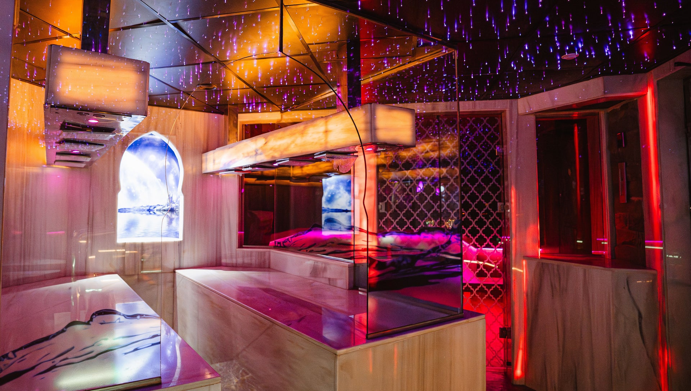

# Sabon Spa — The Blue Sanctuary

> **Luxury Spa, Hammam & Wellness Destination in Tangier, Morocco**  
> *"Sous la surface, le calme absolu."*



---

## Overview

Sabon Spa is an immersive, interactive, production-quality digital sanctuary crafted for Sabon Spa in Tangier (Malabata Bay).

- **Brand Concept:** The Blue Sanctuary (underwater atmospheric luxury)
- **Key Trust Anchor:** 100% Espaces Séparés (Hommes / Femmes)
- **Ratings:** 5.0 ★ Google · 5.0 ★ Tripadvisor · 5.0 ★ Fresha
- **Location:** Résidence Iris, 1 Route de Malabata / Bd Mohammed VI, Tangier 90000, Morocco

---

## Technology Stack

- **Framework:** React 18, TypeScript, Vite
- **Styling:** Tailwind CSS (custom brand tokens, glassmorphism, Moorish architectural arch masks)
- **3D & WebGL:** Three.js (Procedural liquid glass organic centerpiece, real-time GLSL water caustic wave shaders, upward-drifting starfield particles echoing the spa's salt-brick hammam ceiling)
- **Dual-Mode Hero:** Interactive 3D Sanctuary mode + Authentic Hammam Video Reel mode
- **Multilingual:** Seamless French (default) and English toggle
- **High-Touch Conversion:** WhatsApp direct pre-filled messaging, phone links, and interactive reservation request modal

---

## Getting Started

### Prerequisites

- Node.js (v18 or higher)
- npm (v9 or higher)

### Installation

```bash
# Clone the repository
git clone https://github.com/yassine-fariss/sabon-spa.git
cd sabon-spa

# Install dependencies
npm install

# Start local development server
npm run dev
```

### Production Build

```bash
# Typecheck & build static bundle
npm run build

# Preview production build locally
npm run preview
```

---

## Project Structure

```text
sabon-spa/
├── public/
│   ├── images/          # Authentic photography of Sabon Spa
│   ├── videos/          # Ambient video reels of the spa
│   └── logo.jpg         # Official brand mark
├── src/
│   ├── components/
│   │   ├── hero/        # HeroSection & BlueSanctuary3D WebGL
│   │   ├── layout/      # Navbar, Footer
│   │   ├── sections/    # ProofStrip, Introduction, Signatures, Services,
│   │   │                # ImmersiveBreak, Packs, Gallery, WhySabon, Team,
│   │   │                # Reviews, Booking, FAQ
│   │   └── ui/          # BookingModal, Lightbox
│   ├── data/            # Verified business content (FR/EN)
│   ├── styles/          # Tailwind & custom luxury glass styles
│   ├── types/           # TypeScript interfaces
│   ├── App.tsx          # Root application component
│   └── main.tsx         # Application entry
├── tailwind.config.js   # Official brand color tokens
└── vite.config.ts       # Vite configuration
```

---

## License

© Sabon Spa Tanger. All rights reserved.
